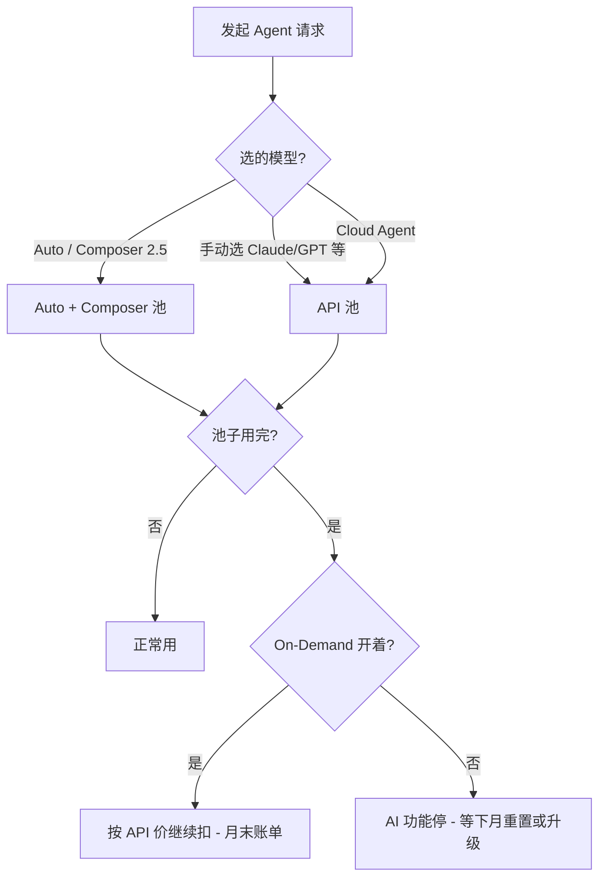

# Cursor 模型付费方案与超额计费调研

## 调研背景

- **为什么要调研**：怀疑 Cursor 产生意外扣费/欠费，需要弄清计费逻辑和止血办法
- **决策要回答的问题**：
  1. 各档位到底包含多少用量？
  2. 什么操作最烧钱（尤其是 Cloud Agent）？
  3. 怎么立刻防止继续超额？
- **调研范围**：个人版 Pro / Pro+ / Ultra、按需计费（On-Demand）、Cloud Agent、主流模型 API 单价

## 方法与来源

- Agent / 模型：Cursor Cloud Agent
- 主要信息源：
  - [Cursor Pricing](https://cursor.com/pricing)
  - [Models & Pricing 文档](https://cursor.com/docs/models-and-pricing)
  - [Usage and limits](https://cursor.com/help/models-and-usage/usage-limits)
  - [Usage-based charges / Overages](https://cursor.com/help/account-and-billing/overages)
  - [Spend limits](https://cursor.com/help/account-and-billing/spend-limits)
  - [Cloud Agents 定价说明](https://cursor.com/help/ai-features/cloud-agents)
- 调研时间：2026-06-09

## 核心结论

1. **是的，这个仓库就是干 Agent 调研归档的**（AgentVault 智研仓），报告、对比表、决策记录都往这儿扔。
2. **Cursor 2026 年个人版 = 月费 + 两个独立用量池**：
   - **API 池**：手动选模型 / Premium / Cloud Agent / Max Mode 走这里，按模型 API 价扣
   - **Auto + Composer 池**：选 Auto 或 Composer 2.5 走这里，额度更宽裕、单价更低
3. **Pro 只有 $20/月的 API 额度**，日常 Agent + Cloud Agent 很容易烧穿；烧穿后若开了 **On-Demand（按需计费）**，会**按 API 原价继续扣、月末结算**——这很可能就是「被干欠费」的原因。
4. **Cloud Agent 必须开启 On-Demand 才能跑**（即使先消耗包含额度），且只支持 Max Mode 兼容的高端模型，**单次任务 token 消耗大**，是高额账单高发区。
5. **立刻止血**：去 [cursor.com/dashboard](https://cursor.com/dashboard) → Spending，把 On-Demand 设为 **Disabled** 或设极低硬上限（如 $0–$5）；日常尽量用 **Auto / Composer 2.5**。

## 详细发现

### 一、订阅档位与包含用量

| 档位 | 月费 | API 池包含额度 | Auto + Composer | 适合谁 |
|------|------|----------------|-----------------|--------|
| Hobby | 免费 | 极少 | 极少 | 试用 |
| **Pro** | $20/月 | **$20** | 较宽裕 | 轻度 Tab / 偶尔 Agent |
| **Pro+** | $60/月 | **$70** | 较宽裕 | 每天用 Agent（官方推荐） |
| **Ultra** | $200/月 | **$400** | 较宽裕 | 多 Agent / 自动化重度用户 |
| Teams Standard | $40/人/月 | 按席位 | 较宽裕 | 团队协作 |
| Teams Premium | $120/人/月 | 5× Standard | 较宽裕 | 团队重度 Agent |

> 官方用量画像（[Models & Pricing](https://cursor.com/docs/models-and-pricing)）：
> - 只用 Tab：$20 以内
> - 偶尔 Agent：常能压在 $20 内
> - **每天用 Agent：总用量通常 $60–$100/月**
> - **多 Agent / 自动化：常 $200+/月**

用量**按订阅日重置**，不结转。Pro 月费 $20 ≠ 送 $20 模型额度之外的「无限 Agent」——$20 就是 API 池预算。

### 二、两个用量池怎么扣钱



**Auto + Composer 池单价**（约）：
| Token 类型 | 价格 / 1M tokens |
|------------|------------------|
| Input + Cache Write | $1.25 |
| Output | $6.00 |
| Cache Read | $0.25 |

**API 池**：按所选模型公开 API 价计费（无加价，个人版）。Teams 非 Auto 请求额外收 **Cursor Token Rate $0.25/1M tokens**。

### 三、哪些模型最烧钱（API 池，$/1M tokens 节选）

| 模型 | Input | Output | 备注 |
|------|-------|--------|------|
| Composer 2.5 | $0.5 | $2.5 | 走 Auto 池更划算 |
| GPT-5 Mini / Codex Mini | $0.25 | $2 | 相对便宜 |
| Claude 4.6 Sonnet | $3 | $15 | 常用高端 |
| Claude 4.6/4.7 Opus | $5 | $25 | 很贵 |
| Claude Opus Fast mode | $30 | $150 | 极贵 |
| GPT-5.5 | $5 | $30 | 新旗舰 |
| GPT-5.4 | $2.5 | $15 | Max Mode 长上下文 2× input |

**烧钱因子**：
- 手动选 Opus / GPT-5.5 / Fast mode
- **Max Mode**（更大上下文 = 更多 input tokens）
- **Cloud Agent** 长任务、多轮 tool call、读大量代码
- 多仓库、大 codebase 上下文

### 四、Cloud Agent 计费要点

- 所有付费档可用；按所选模型 **API 价** 计费
- **只支持 Max Mode 兼容模型**
- **必须先开启 On-Demand** 才能启动（首次会要求设 spending limit）
- 先扣 API 池包含额度，用完再走 On-Demand
- 官方提示：硬上限下需留 **~$2 headroom**，否则 Agent 可能启动失败
- Automations（定时/事件触发 Cloud Agent）会**持续产生费用**

### 五、On-Demand（按需超额）—— 欠费元凶

机制（[Overages 文档](https://cursor.com/help/account-and-billing/overages)）：
- 超出包含额度后，若 On-Demand **已开启**，按 **API 原价** 继续服务
- **月末结算（billed in arrears）**，账单里会有单独的 On-Demand 行项目
- 首次开启时默认上限可能是 **$200**（社区反馈曾有 $50 默认值被重置的情况）

**常见踩坑**：
1. 跑 Cloud Agent 时开了 On-Demand，任务跑很久，额度 + 超额一起爆
2. 手动选高端模型做重度 Agent 调研（比如本仓库这种长对话）
3. 以为 $20/月 Pro = 固定月费封顶，实际 API 超额另算
4. 开关 On-Demand 时 spending limit 被重置为默认值

### 六、怎么查账单 & 止血

**查用量**：
1. 打开 [cursor.com/dashboard](https://cursor.com/dashboard)
2. **Usage**：实时用量、剩余额度
3. **Billing & Invoices**：
   - Included Usage = 月费包含的
   - On-Demand Usage = 超额部分（重点看这里）

**止血（按优先级）**：

| 操作 | 路径 | 效果 |
|------|------|------|
| 关闭 On-Demand | Dashboard → Spending → Monthly Limit → **Disabled** | 额度用完即停，不再扣超额 |
| 设硬上限 | Settings → Plan & Usage → On-Demand → Fixed $N | 到上限停服 |
| 换便宜模型 | Agent 里选 **Auto** 或 **Composer 2.5** | 走更便宜的池子 |
| 升级档位 | Pro+ ($60, $70 API) / Ultra ($200, $400 API) | 扩大包含额度 |
| 自带 API Key | 设置里配 BYOK | 部分场景直连厂商计费（Teams 仍有 Token Rate） |

编辑器内路径：**Settings → Plan & Usage → On-Demand Usage → Monthly Limit**

### 七、方案怎么选（决策树）

```
你每天怎么用 Cursor？
├─  mostly Tab 补全 → Pro ($20) 够用
├─  偶尔问 Agent → Pro + 关 On-Demand 或上限 $5
├─  每天 Agent / 本仓库这种调研 → Pro+ ($60) 起步
├─  Cloud Agent 自动化 / 多任务并行 → Ultra ($200) 或严格 On-Demand 上限
└─  团队 → Teams $40/人，注意 Token Rate；Enterprise 可池化用量
```

**若已被扣很多**：
- 先关 On-Demand，避免继续烧
- 核对 Billing 里 On-Demand 分项和模型明细
- 争议账单可邮件 **hi@cursor.com** 或 [论坛](https://forum.cursor.com)

## 风险 & 未决问题

- 各模型「Hidden by default」列表会更新，以 dashboard 实时价为准
- Auto 池「Generous included usage」无公开精确数字，重度使用仍可能触顶
- Promotional 免费 Cloud Agent 环境次数可能让人低估真实成本
- 汇率、发卡行境外手续费不在 Cursor 账单内

## 建议下一步

- [ ] 立刻登录 Dashboard 查 On-Demand 是否开启、本月 On-Demand 金额
- [ ] 将 On-Demand 设为 Disabled 或 $5 硬上限（若仍需 Cloud Agent 则设明确上限）
- [ ] 日常 Agent 改用 Auto；调研类长任务评估是否升级 Pro+
- [ ] 若经常用 Cloud Agent，设 Automations 预算意识（每次 PR 任务 ≈ 一次长 Agent run）

## 附录

### 参考资料

- https://cursor.com/pricing
- https://cursor.com/docs/models-and-pricing
- https://cursor.com/help/models-and-usage/usage-limits
- https://cursor.com/help/account-and-billing/overages
- https://cursor.com/help/account-and-billing/spend-limits
- https://cursor.com/help/ai-features/cloud-agents
- https://forum.cursor.com/t/what-is-the-pricing-structure-for-using-cloud-agents/156843

### 一句话给未来的自己

> **Pro 的 $20 是 API 额度不是月费封顶；Cloud Agent + On-Demand = 欠费组合拳。先关超额，再选档位。**
